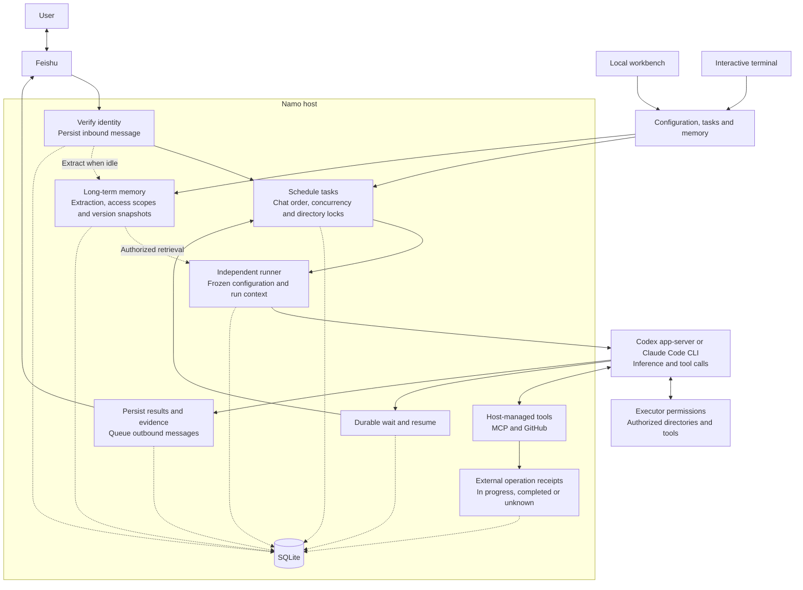

# Architecture

Namo handles identity, permissions, task scheduling and delivery. The executor registry binds each task to the official Codex app-server or Claude Code CLI.

The service uses TypeScript, Node.js 24.15+, SQLite and the official Feishu SDK. The local workbench uses React, Radix Themes, Lucide and Vite. Schema 16 defines tables and indexes in [schema.ts](../src/schema.ts). Initialization and version checks live in [schema-migrations.ts](../src/schema-migrations.ts).

## Message and task lifecycle



A workstream connects successive tasks. A single task may have several runs separated by waits and resumptions. Namo stores chats, workstreams, tasks and native executor sessions separately. Switching with `/agent` restores the selected executor’s workstream for the current user and chat. Each existing task keeps the executor it was created with.

Namo commits an inbound message before acknowledging receipt. The scheduler dispatches an independent runner. Codex uses approved directories and Skills in its sandbox and accesses MCP and GitHub through host-managed tools. Claude Code uses a restricted CLI with file tools in authorized directories and Bash in the OS sandbox. A Codex task can enter a durable wait for a user answer or an external condition, then resume. Namo saves results and evidence before queuing delivery to Feishu. Model completion, platform acceptance and user receipt are recorded separately.

## Modules and invariants

| Responsibility | Entry points | Required behavior |
| --- | --- | --- |
| Inbound messages and scheduling | [engine](../src/engine.ts), [tasks](../src/tasks.ts) | Commit before acknowledgment. Serialize work per chat, enforce global concurrency and exclude overlapping real directories. |
| Independent execution | [runner](../src/runner.ts), [worker](../src/runner-worker.ts) | Give each run one owner. Reattach to the original run after receiver restart. Retain lost runs for reconciliation. Cancellation stops only the owning process group. |
| Codex protocol | [connection](../src/codex-connection.ts), [runtime](../src/runtime.ts) | Use the official provider, isolated authentication and allowlisted directories. Keep revisions with unknown receipts for reconciliation. |
| Claude Code protocol | [claude-runtime](../src/claude-runtime.ts), [agent-registry](../src/agent-registry.ts) | Isolate authentication and sessions, restrict file tools and resume by explicit session ID. Cancel or time out the owning process group. |
| Restricted browser prototype | [ego-browser-prototype](../src/ego-browser-prototype.ts), [worker](../src/runner-worker.ts) | Require task approval or an explicit persistent grant from a paired user in a direct chat. The host binds the browser space to the run. Execute only listed operations and avoid retries after unknown outcomes. |
| Human and external waits | [waits](../src/waits.ts), [external-waits](../src/external-waits.ts) | Release execution resources while preserving chat order. Bind answers to identity and version, pin the GitHub HEAD, and consume each resumption once. |
| Identity and resources | [access](../src/access.ts), [path-policy](../src/path-policy.ts), [skill-access](../src/skill-access.ts) | Enforce organization admission. Admitted members share writable directories and MCP. Recheck permissions on resume and delivery. Keep individual Skill enablement settings. |
| Profiles and memory | [assistant](../src/assistant.ts), [memory](../src/memory.ts), [extractor](../src/memory-extractor.ts) | Require explicit profile activation. Record the source and scope of long-term facts. Honor manual corrections, deactivation and deletion during automatic extraction. |
| Materials and artifacts | [materials](../src/materials.ts), [image-inputs](../src/image-inputs.ts), [artifacts](../src/artifacts.ts) | Bound reads of authorized source messages and freeze images and files for delivery. Message text cannot grant access. Reject out-of-scope and sensitive paths. |
| Progress and delivery | [public-progress](../src/public-progress.ts), [feedback](../src/feedback.ts), [recovery](../src/recovery.ts) | Show public progress and bounded evidence. Save results before sending. An unknown delivery must not trigger another model run or a blind resend. |
| GitHub and Git pushes | [github-api](../src/github-api.ts), [github-review](../src/github-review.ts), [approvals](../src/approvals.ts) | Pin identity and target. Persist a receipt before a write, reconcile unknown outcomes and consume each push authorization once. |
| Management and releases | [management](../src/management.ts), [terminal-config](../src/terminal-config.ts), [config-prompts](../src/config-prompts.ts), [service](../src/service.ts), [release](../src/release.ts) | Share configuration validation, version checks and backups across the terminal and workbench. Queries must not migrate databases. Apply saved configuration after draining the old queue. Verify backups before switching immutable snapshots. |

For numeric limits, state enums and complete field definitions, see the implementation and [contract tests](../test/).

## Design decisions

### Data and recovery

SQLite stores inbound messages, tasks, runs, waits, outbound messages and audit records. Transaction order determines which cancellation, answer or resumption takes effect. An expired heartbeat does not transfer execution ownership. Directory reservations remain until the lost process and its descendants are accounted for. Completion of a model run, platform acceptance of a message and actual user receipt each need their own evidence.

The [daily model turn limit](../src/daily-turns.ts) counts foreground and background model calls by UTC day. During a receiver switch, a turn can be refunded only when Namo can establish that it never reached the runner. Completed-run reservations may be cleared while retaining the cumulative count.

Schema 13 is the development baseline. Schemas 13–15 can migrate to 16 after an offline backup. An empty database initializes in one transaction and rolls back on failure. Namo rejects writes to incompatible older databases and leaves their files intact. See the [rebuild procedure](operations.md#installation-upgrades-and-rollback).

| Domain | Tables and constraints |
| --- | --- |
| Long-term memory | `memories` stores ownership, scope and version. `memory_contents` links bodies by a versioned foreign key and is read only after authorization. Changes, run snapshots and fingerprints that prevent deleted facts from reappearing are stored separately. |
| Automatic extraction | `memory_jobs` stores state, retries and leases. Deduplication keys and source messages have separate relations from model run IDs. |
| Git approvals | `git_approvals` ties a task to a frozen target and permissions. `approval_jobs` links inbound commands and schedules them by state. |
| External waits | `external_waits` links tasks and runs. Each task can have one active wait. `external_wait_links` maps it one-to-one to a human wait. |
| Directory snapshots | `task_directories` stores canonical paths per task. Historical v14 tasks are backfilled from their working directories. Task, message and receipt records are preserved. |
| File delivery | `artifact_intents` links task instructions. `artifact_deliveries` stores file identity, send UUID and receipt state. |

Completion events for the official image generation tool in the current thread and turn can trigger delivery. Namo reads images only from that thread’s isolated output directory, freezes them in the task workspace and records a content hash. The persistent runner returns the image identity. The receiver registers a separate delivery in the transaction that completes or parks the task. It rechecks authorization and contents before sending. Image messages and oversized images sent as files each have their own receipts. Unknown outcomes are never blindly retried. A path in model output cannot trigger this process. An explicit file delivery intent for the same content is fulfilled once.

New domain tables use SQLite STRICT typing, foreign keys and state constraints. Indexes support state queues, ownership queries and historical ordering. Bounded lists, evidence and frozen snapshots use JSON. These domain records have dedicated tables outside `settings`.

### Directories and execution context

Ordinary tasks may read host files except Namo’s configuration, data, isolated login directories and explicitly denied paths. Admitted members can write to `codex.directories`, their task workspace and the system temporary directory. Other host configurations and credentials may be readable unless explicitly denied. Admit only trusted members. Authorized MCP connections are shared, and requested reads and writes execute without per-call approvals.

New tasks always start in an isolated conversation directory. Initialization requires explicit writable directories. Legacy configuration is converted to a directory list when read. Saving removes old fields and creates a private backup. Legacy `readPaths` never gain write access during migration. `task_directories` freezes the working directory and complete writable set per task. Running tasks and lost-run reservations exclude overlapping paths, so even distinct chats may serialize when they share writable directories. Memory extraction has a separate, restricted read-only policy.

Each run freezes input, writable directories, permissions, assistant settings and memory versions. Ordinary configuration saves preserve active runs and already-created queued tasks. The receiver defers task creation, drains the old queue, applies the new configuration, then processes newly persisted requests. Changing only the default model preserves native context. Changing directories or execution policy rebuilds the model session within the same workstream with bounded history excerpts. Old task records remain intact. Revoked organization access can still block execution and delivery. Workers receive effective configuration through a private pipe. Model processes do not inherit host Feishu or GitHub credentials.

### Memory and background work

When foreground work is idle, the service’s default executor extracts evidence-backed long-term facts from direct user messages. Extraction uses a separate temporary session with tools and custom extensions disabled. Both executors share a memory store. Namo checks the `global` or `local` knowledge level, `shared`, `private` or `chat` disclosure scope, and source directory permissions separately. Global facts can still be private. Temporary instructions stay in task context. Imported candidates need manual activation. Removing a memory does not purge existing sessions or historical copies.

The workbench shows per-user queue summaries and the 20 most recent extraction records. It distinguishes empty input for storage, rejected candidates and execution failures. Each job gets at most three attempts. Foreground preemption does not count as failure. Only known error categories are recorded and displayed. Raw messages and SDK errors stay out of diagnostics.

[Background work](../src/background-work.ts) queries indexed domain queues directly. Interrupted approvals and file sends with uncertain outcomes enter `unknown` and require reconciliation.

### Feedback

By default the first card has a 200 ms coalescing window, progress updates use a 5 s interval and status confirmations use a 30 s interval. These values control scheduling. Client display latency is measured separately. Slow reactions or card updates cannot block the final result. Progress summarizes actual public events and excludes private reasoning and invented completion percentages. Image previews and streaming cards are still pending.

### External operations and known limits

Admitted members share the connected GitHub account’s actual API permissions in direct and group chats. PR review and CI waits do not implicitly authorize writes. The Git push entry point rechecks task, commit, branch, remote, expiry and configuration revision. Its protections apply only to that entry point. Operations within the user’s request, current permissions and settings can execute without further confirmation. Human waits collect missing information.

MCP call receipts are scoped to the task. They cannot deduplicate operations across tasks. If authorization or response-size checks fail after a call returns, the receipt may already show completion and another call with the same parameters can still occur within the task. Reconcile uncertain external state at the server. Receipts cover MCP `call`. Identical parameters alone do not identify a logical operation. GitHub’s uncertain-write protection is also task-scoped.

Resuming a ready wait that uses a static GitHub token does not currently re-query remote authorization. Public progress may count a successful tool RPC as a success even when the business outcome is unknown. Lost-runner detection uses PID existence, so PID reuse can keep a reservation occupied. The sandbox’s private-directory denial still needs verification when the data directory is a symlink and the allowlist contains the parent of its real path.

### Management, upgrades and extensions

`namo config` manages execution, organization access, connections, the assistant, profiles and updates in a TTY. Field drafts stay in memory. The terminal shares the management layer’s permissions, revision checks, save logic and automatic configuration switching. Esc can discard the current draft. MCP OAuth accepts the local callback URL through hidden input and reuses state, PKCE and configuration checks. The menu runs independently of the receiver. Browser theme settings and the desktop directory picker apply only to the workbench.

The workbench listens on loopback and uses one-time startup authorization, an HttpOnly session, Host and Origin validation, and a content security policy. Browser code shares only the [UI contract](../src/ui-contract.ts) with the server. The receiver stays pinned to a verified release snapshot. The [runtime host](../src/runtime-host.ts) can replace compatible execution code while the receiver stays connected. During the switch, incoming messages are acknowledged only after commit. New tasks use the new runtime. Existing independent workers keep their version. Backups use a WAL-consistent snapshot. Verification or loading failures preserve the old runtime. Unknown sends are never replayed. Incompatible receiver, storage or dependency changes leave the service running and require an offline upgrade. See the [operations guide](operations.md).

`namo ui --remote` explicitly starts a separate loopback process. Before shared workbench routing, [remote-ui](../src/remote-ui.ts) checks the configured HTTPS Host and Origin and handles sign-in, sign-out and in-process sessions. The reverse proxy supplies HTTPS and the access boundary. Ordinary `namo ui` uses local startup authorization. See the [bundled setup and verification guide](../skills/namo-remote-workbench/SKILL.md).

The [runtime contract](../src/runtime-contract.ts) defines execution, revision, wait, cancellation and evidence interfaces. Namo has no additional agent SDK, probe, registration UI, dynamic loader or multi-agent router. Legacy Codex profile bindings are read for compatibility. Retired adapters cannot fall back to execution. Future plugins must respect the same permission, scheduling and delivery rules.

<a name="开发与验证"></a>

## Development and verification

Run these commands from the repository root with pnpm 12.15.0. The project uses one lockfile, `pnpm-lock.yaml`.

```sh
pnpm install --frozen-lockfile
pnpm run build
pnpm cli ui
pnpm test
pnpm run smoke:codex
```

| Package script | Purpose |
| --- | --- |
| `build`, `build:server`, `build:ui` | Build the whole package or one side. The UI build includes type checking. |
| `typecheck:ui`, `ui:watch` | Check UI types or rebuild on changes. Refresh the local workbench to see changes. |
| `test` | Build and run isolated regressions for current test sources with concurrency 4. Stale compiled files for removed tests are excluded. |
| `smoke:codex` | Check the official protocol, account and permissions handshake. Add `-- --run` only for real inference. |
| `smoke:skills` | Verify Skill read/write boundaries in the actual sandbox without calling a model. |
| `prepack`, `cli` | Build before packaging and run the CLI entry point. |

Tests live under `test/` by feature. Shared waits and fixtures live in `test/helpers.ts`. Add boundary cases to the relevant suite.

`pnpm pack` builds a local package for verification. Inspect it for runtime resources and documentation and check that private configuration, data, logs and credentials are excluded. Builds leave the running service on its registered release. For documentation edits, check local links and factual status claims.

The UI build generates the workbench changelog from Git. Version changes in `package.json` on the main branch mark release boundaries. Merged `feat`, `fix`, `perf` and `style` commits provide entries. Update `package.json` for a new release and build normally. Generation reads committed history, displays commit messages in their original language and filters likely sensitive content. It leaves source files and the Git index alone. Curated older releases retain bilingual descriptions. Shallow clones and checkouts without full history fall back to stored history and flag unavailable details for newer versions. CI fetches full history. The distributed package runs without Git.

On main pushes and PRs, [CI](../.github/workflows/ci.yml) runs builds and tests on Linux and macOS using Node.js 26. It then checks packaged runtime files, UI assets and exclusions with `node scripts/check-package.mjs`. The same command works locally. Live Codex and Feishu acceptance checks run locally, outside CI.

Use Lucide icons, the [bundled font licenses](../assets/fonts/README.md) and the existing [Namo logo](../assets/namo-logo.png). UI copy uses stable English message IDs. Keep placeholders identical in both locales.

### Schema 16 directory migration

`schema-directory-migration.ts` upgrades v15 to v16 in one transaction. Versions 13 and 14 first run the existing migrations to backfill task directory snapshots. The migration removes named-resource columns from workstreams, tasks and Git approvals. Deliveries use `rootDirectory`, memories and extraction jobs use `directory`, and the knowledge category uses `knowledge`. It also converts material bindings and import deduplication records. For older MCP read credentials, it preserves the original signature context and upgrades the signature only after verification.

The migration resolves old names against the working directories of historical tasks and workstreams. Ambiguous owner-directory memories fall back to owner scope. Ambiguous local memories fall back to global level. Ownership, private/chat disclosure restrictions, contents, versions, dependency chains, deletion state, audit records and run snapshots are preserved. If several names map to one directory, all import records survive. Historical messages, prompts, events and previous backups retain the original names.

Stop the service and create a verifiable backup before migration. Foreign keys are checked before commit. Any error rolls back the transaction and leaves the database intact. The management UI checks the version without running migrations. To return to an older version after upgrading, restore the matching pre-upgrade database, configuration and release together. An older version cannot open the v16 database directly.
