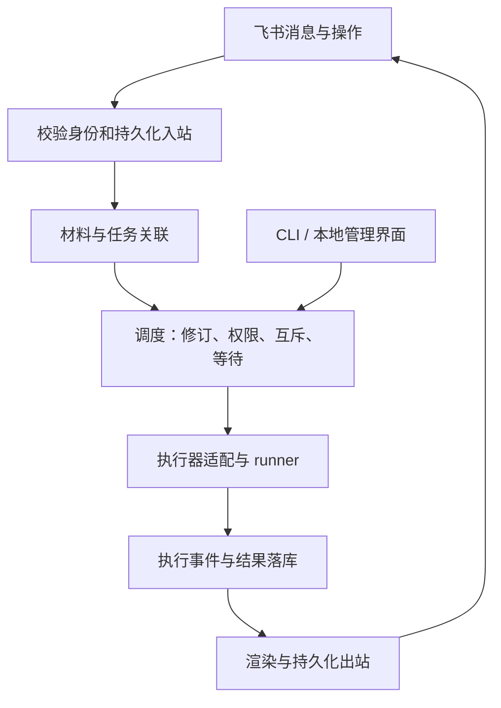

# Namo 架构与业务契约

更新：2026-10-26。本文区分目标架构与已实现范围；阶段状态以 [开发计划](development-plan.md) 和验收记录为准。

## 定位与分工

Namo 是本地 Agent 任务网关，配套轻量本地管理界面。CLI 管安装维护，飞书管远程工作，本地 Web 管日常配置和诊断。Namo 管消息、项目、任务、权限、调度与交付；执行器管理原生上下文、规划和工具调用。首期只有官方 Codex app-server，不自建模型循环，不引入第三方模型入口。

保持 TypeScript、Node.js 24.15+、内置 SQLite、官方飞书 SDK 的单机结构。以下模块不代表独立服务：

## 五个不同的对象

| 对象 | 职责 |
| --- | --- |
| 聊天 / 话题 | 输入与回复的渠道位置，不等于 Agent session |
| 项目 | 真实目录、仓库与权限范围 |
| 工作线 | 持续目标，跨多次任务保留关联，不等于共享全部历史 |
| 任务 | 一次可验收的工作，有来源、持有者、修订、执行和交付记录 |
| Agent session | 特定执行器的上下文容器，可续接、替换或交接 |

同聊天不同话题可绑定不同工作线；同一项目可以有多条工作线。跨聊天 / 跨用户不自动共享 session；跨入口续接必须核对访问权限和接收范围。当前同聊天串行继续保留，后续放宽需单独验收。

## 消息入口

身份来自飞书事件，引用 / 转发的说话人只是材料来源。消息保留类型、话题、引用、时间与可用材料描述；模型输入分别标记实际用户要求和不可信材料，不把转发中的“批准”当授权。

输入分指令、材料、修订、控制与系统事件。先持久化、再 ACK；慢速引用 / 转发解析不阻塞入站落库。解析能力不足时保留描述和限制，不伪装成已读取附件。

独立转发、附件和显式材料等待处理说明；同一用户、同一话题、同一项目内关联，过期只提醒，不据内容自动开工。普通明确文字可直接建任务；短窗口合并是后续体验优化，不能代替语义关联。群旁听尚未启用，未来必须显式配置采集范围和期限。

## 任务与修订

任务保存来源消息、所属工作线、操作者、项目 / 目录、执行权限指纹、输入版本。消息通过角色关联任务（指令 / 材料 / 修订），不能靠拼成长文本丢掉来源。一条消息未来可拆多任务，但 M1 不自动拆单。

补充优先通过明确任务编号或引用任务消息关联；存在歧义时询问，不猜测。排队任务执行前组装全部修订；运行中补充通过能力适配器追加，记录待处理、提交中、执行器接受或未知。执行器接受不代表模型已理解或已撤销此前操作。原轮已结束时只在有明确未接受证据的情况下另开续轮；结果不明不自动重送。

任务执行状态与投递状态分开。模型成功、平台接受、用户收到 / 已读是三件事。未投递结果从出站账恢复，禁止因此再调用模型。执行中断或外部效果未知时记录受阻事实，先核对，不自动重放。

### M1 已实现的边界

- `inbox.envelope` 是有界结构化投影，含话题、引用、发送时间、材料描述与解析限制，不保留原始 SDK 对象。
- 新增 `workstreams / bindings / tasks / task_messages / task_runs`；保留旧入站、出站、session 和设置。任务号 `N-…`，工作线号 `W-…`；M1 一条指令建一任务，多条材料 / 修订关联同一任务。
- `/material` 与独立附件 / 合并转发暂存 10 分钟；按用户、话题和项目 / 权限指纹关联，至多 30 条材料，组合输入不超 80000 字符。未知引用不抓取、不推断原文，已知本人任务及待处理材料可引用。
- `/amend` 或任务引用追加要求；任务领取时冻结本轮输入版本，之后的补充只能走追加通道，不重复混入首轮 prompt。提交前持久化 `submitting`，回执标记 `accepted / not_active / rejected`，超时 / 断流标记 `unknown`。重启不重送。
- 任务状态为 `queued / running / succeeded / failed / cancelled / interrupted / needs_attention`，投递状态保留在 outbox。未确认补充使任务进入 `needs_attention`，不能伪称完整交付。
- `/tasks /task /session /new` 提供文本管理入口；取消限同用户、同聊天，先持久化再中断。未做自然语言自动识别补充、跨聊天续接或独立后台 runner。M2 增加可选卡片操作。
- 旧项目选择保留；旧 session 仅在同聊天、同目录且发送者唯一时安全继承，其余保留原记录并新建 session。不同话题和用户默认分开，当前整个聊天仍串行。

2026-10-26 在明确授权的维护窗口完成既有服务升级；真实私聊已验证材料归集、运行中引用追加、新工作线隔离、空闲重启、显式续接和取消。群话题、跨聊天并发及故障场景仍以隔离测试为证据，详见 [M1 验收](m1-verification.md)。

## 调度与权限

保留同聊天串行和全局并发限制，增加按真实项目目录的互斥；首版串行同目录所有任务。目录存在父子包含关系时也冲突。M1 不自动建 worktree；未来独立 worktree 仍需保护共享 Git 和外部资源。

项目、工作线与 session 在建任务时绑定，默认项目改变不使排队任务转向别处。权限变更需再次校验，不能沿用扩大权限的旧假设。任务取消核验来源用户与聊天，仅中断对应任务；取消不回滚文件或外部操作。

Codex 适配声明续接、补充、中断等能力；业务调度不依赖厂商专有错误文案。Claude Code 作为未来执行器，OpenClaw 作为外部网关，两者不强行套用完全一致的生命周期。

## 记忆与交接（M4）

实时状态读 SQLite / 外部真源；稳定项目约定和用户明确偏好记录范围、来源和版本；摘要只用于交接；历史原话按权限检索。检索先过滤权限，私聊材料不默认进入群聊。记忆和模型历史都不是新的操作授权。先做有限项目记录与原话检索，不预先引入向量数据库。

## 异常核对（M1 扩展，schema 2）

`Recovery` 共用于 `/issues /issue /resolve`、CLI 和本地 UI。任务执行结论与消息投递事实分别核对：

- 执行中断 / 失败 / 未确认补充：检查 Git、文件和外部效果后标记已核对；保留原执行结论，不新建运行或自动重送修订。
- 投递异常：人工确认收到、放弃发送，或明确重发指定分段。重发使用已保存结果和新的发送 UUID，不再调用模型；之前的状态、内容摘要和 UUID 保留在审计记录。
- `sent` 是平台创建回执，`confirmed` 是人工核对，`dismissed` 是放弃发送；互不冒充。只有全部结果分段收口才解除等待。放弃任意结果分段会将入站标为 `delivery_closed`。
- M1 之前的消息缺少独立执行记录，历史投递错误可能已覆盖原执行错误；核对后保留 `legacy_execution_unverified`，不会凭“收到回复”宣称执行成功。

操作绑定记录快照、操作者、动作、依据和唯一请求编号，事务化写入 `reconciliations` 后才改变状态。飞书入口限定本人、本聊天；本地管理入口代表已通过本机启动授权的所有者。快照变化或动作不适用时拒绝，重复请求幂等。

## 本地配置与卡片（M2 第一批）

`namo ui` 启动独立的回环 HTTP 界面，不连接飞书或启动执行器任务。`Management` 共用配置解析、探针、服务管理及 SQLite 模型；读取旧 schema 不迁移，写入必须匹配 schema 2。登录和配对仍由页面引导至已有本机 CLI。

浏览器通过 5 分钟内单次可用的 URL fragment 换取 2 小时的 HttpOnly / SameSite 会话，随后清除 fragment；仅绑定 `127.0.0.1`，校验 Host 与写入 Origin，禁用跨域访问和缓存。原 Secret、认证文件和未知配置字段不返回页面；替换 Secret 为只写操作。

配置先校验、冲突检测、私有备份和原子保存，再由用户单独确认应用。在线进程报告启动时的配置指纹，区别保存与生效；旧进程显示未知。应用前必须确认服务版本、后台注册和队列空闲，在 SQLite 中暂停领取与检查空闲是同一事务，再调用原有服务管理入口。前台实例、旧版进程及在途任务均拒绝自动重启。暂停期间新消息仍可持久接受，已有任务的目录和权限快照不会改变；重启后权限不匹配会明确终止，不能默默扩大。

`feishu.cards` 默认 false。启用后，任务接收和结果由代码渲染固定卡片，模型输出作为纯文本；不解析 HTML 或执行模型生成的按钮。卡片 payload 在发送前冻结并持久化。按钮使用有时限的随机 token，绑定任务、输入版本、出站记录及平台消息回执；取消先持久化，再通知对应运行停止。查看状态只发送当前数据库投影，不调用模型。

首批卡片是独立接收 / 结果消息，不原位流式更新，因此晚到进度不能覆盖终态。仅格式明确被拒绝时允许改发文本；超时或回执未知保留异常，避免自动重复消息。具体修改、验证、产物仍由结果原文表达，结构化证据提取和真实回调验收尚未完成。

## 后续优化（M3–M5）

自优化先采集真实失败和纠正案例，离线回放后提出可回退改动。不得自动扩大权限、跨范围共享记忆、重放结果未知的操作，或让错误反馈不断繁殖规则。

## 迁移与上线

保留既有配置和 `inbox / outbox / sessions / settings`，数据库迁移必须事务化、可重复并保留历史。旧待执行输入不能因新路由被丢弃，旧进行中输入不能被自动重跑。先在旧结构 fixture 和真实数据库私有快照验收；开发时不迁移在线库、不重启接收服务、不启动同应用第二接收端。上线前安排维护窗口和一致性备份；回退不能让旧版重放新版尚未核对的任务。

schema 2 只增加 `reconciliations / card_actions` 与 `outbox.payload`，保留原九张表的字段和数据。真实库副本迁移及重复打开通过；在线仍为 schema 1，M2 尚未切换。M1 二进制拒绝新版 schema，不能直接降级消费新版库。

推送、部署和发布前确认仍然有效。持久化审批尚未实现时，不宣传为命令级强制安全边界。
