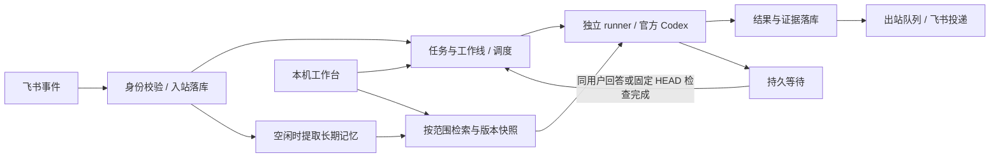

# 技术实现

Namo 负责身份、权限、任务调度和交付，官方 Codex app-server 负责推理与工具执行。当前只支持 Codex；其他 Agent 仅保留内部扩展接口。

技术栈：TypeScript、Node.js 24.15+、SQLite、飞书官方 SDK；本地 UI 使用 React、Radix Themes、Lucide 和 Vite。当前 schema 为 14：表与索引集中在 [schema.ts](../src/schema.ts)，初始化和版本检查集中在 [schema-migrations.ts](../src/schema-migrations.ts)。

## 主链路



工作线关联连续任务；一次任务可包含多个等待 / 恢复运行。聊天、工作线、任务与 Codex 原生 session 分别保存，不能互相当作身份或权限凭证。

## 模块与约束

| 模块 | 实现入口 | 必须保持的行为 |
| --- | --- | --- |
| 入站与调度 | [engine](../src/engine.ts)、[tasks](../src/tasks.ts) | 先落库再确认；同聊天串行、全局限流、重叠真实目录互斥 |
| 独立执行 | [runner](../src/runner.ts)、[worker](../src/runner-worker.ts) | 唯一运行归属；接收端重启后关联原运行，失联不重启模型；取消只停止所属进程组 |
| Codex 协议 | [connection](../src/codex-connection.ts)、[runtime](../src/runtime.ts) | 官方 provider、独立认证、项目权限；修订回执未知时不自动重送 |
| 人工 / 外部等待 | [waits](../src/waits.ts)、[external-waits](../src/external-waits.ts) | 等待释放执行资源，保留聊天顺序；回答绑定身份和版本；GitHub 固定 HEAD，恢复只消费一次 |
| 身份与资源 | [access](../src/access.ts)、[path-policy](../src/path-policy.ts)、[skill-access](../src/skill-access.ts) | 组织准入和项目授权分开；续接与交付重验权限；Skills 仅只读开放启用的具体目录 |
| 档案与记忆 | [assistant](../src/assistant.ts)、[memory](../src/memory.ts)、[extractor](../src/memory-extractor.ts) | 档案显式启用；长期事实带来源和范围；人工纠正、停用、删除不能被自动恢复 |
| 材料与产物 | [materials](../src/materials.ts)、[image-inputs](../src/image-inputs.ts)、[artifacts](../src/artifacts.ts) | 有界读取授权原消息；图片和交付文件冻结内容；正文不能生成授权，拒绝越界及敏感路径 |
| 展示与投递 | [public-progress](../src/public-progress.ts)、[feedback](../src/feedback.ts)、[recovery](../src/recovery.ts) | 只展示公开进展与有界证据；结果先保存再发送；未知投递不重试模型或盲重发 |
| GitHub / 推送 | [github-api](../src/github-api.ts)、[github-review](../src/github-review.ts)、[approvals](../src/approvals.ts) | 固定身份与目标；写操作先存回执，未知结果不自动重试；推送批准只消费一次 |
| 管理与发布 | [management](../src/management.ts)、[service](../src/service.ts)、[release](../src/release.ts) | UI 查询不迁移库；保存与应用分离；校验备份后切换不可变快照 |

数值预算、状态枚举和完整字段以这些模块及 [test](../test/) 中的契约测试为准，不再逐份复制到文档。

## 关键设计

**数据与恢复。** SQLite 保存 inbox、task、run、wait、outbox 和审计。取消、回答、恢复以事务顺序决定归属；心跳过期不转移执行权，失联进程及后代核对完成前保留目录占位。模型完成、平台接受、用户收件是三类事实，不能相互推断。

开发期采用 v13 基线，不再维护 v0–12 的兼容转换。v13 可在停机备份后事务迁移到 v14。空库在一个事务中初始化，失败整体回滚；不兼容旧库明确拒绝写入，绝不自动删库。重建步骤见[运维指南](operations.md)。

| 数据域 | 独立表与约束 |
| --- | --- |
| 长期记忆 | `memories` 存归属、范围和版本；`memory_contents` 通过版本外键关联正文，授权后才读取；变更、运行快照和禁止复活指纹分别保存 |
| 自动提取 | `memory_jobs` 存状态、重试和租约；来源去重键与来源消息分别关联，不伪装成模型运行 ID |
| Git 审批 | `git_approvals` 关联任务并冻结目标与权限；`approval_jobs` 关联入站命令，按状态调度 |
| 外部等待 | `external_waits` 关联任务 / 运行；同任务只能有一个活动等待，`external_wait_links` 与人工等待一对一关联 |
| 文件交付 | `artifact_intents` 关联任务指令，`artifact_deliveries` 保存文件身份、发送 UUID 和回执状态 |

新业务表使用 STRICT 类型、外键和状态约束；状态队列、归属查询和历史排序有对应索引。JSON 仅用于有界列表、证据和冻结快照；这些业务记录不再存入 `settings`。

**上下文。** 每次运行冻结输入、项目、权限、助手设置和记忆版本。普通配置保存不改变既有运行；组织授权撤销仍会阻断执行及交付。worker 通过私有管道接收生效配置，模型不继承宿主飞书 / GitHub 凭据。

**记忆。** 默认在前台任务空闲时，从直接用户消息提取有证据的长期事实；独立临时 Codex 轮次关闭项目工具、hooks、插件及沙箱网络。`global / local` 知识层级与 `shared / private / chat` 披露范围、来源项目授权分别检查；全局存储不代表公开。临时要求不写长期记忆，迁移候选须人工启用。既有 session 与历史副本不会随删除自动清除。

工作台按用户展示提取队列概况与最近 20 条记录，区分无可保存内容、候选未采用和执行失败。最多尝试三次，前台任务抢占不计失败；仅保存和展示已知错误类别，不暴露原始消息或 SDK 错误。

**后台工作。** [background-work](../src/background-work.ts) 直接查询业务队列索引，不再用触发器维护重复的调度表。审批执行中断、文件发送结果不明仍进入 `unknown`，不自动重试。

**反馈。** 默认首卡合并窗口 200 ms、进展更新间隔 5 s、状态确认间隔 30 s；这是调度配置，不是客户端时延承诺。慢表情和卡片更新不挡最终结果；只汇总真实公开事件，不展示原始思维链或编造完成比例。图片预览与流式卡片尚未实现。

**外部操作。** 群聊 GitHub 只读，本人私聊按授权使用账号 API；PR 审查和 CI 等待不隐含写操作。Git push 入口重验任务、提交、分支、远端、有效期与配置版本；该入口只提供有限保护，不是所有通用工具的强制审批边界。人工等待也不等于外部操作批准。

**管理与升级。** UI 仅绑定 loopback，使用一次性启动授权、HttpOnly 会话、Host / Origin 校验和 CSP；浏览器仅导入 [ui-contract](../src/ui-contract.ts)。接收器固定在校验过的发布快照。兼容的执行代码可通过 [runtime-host](../src/runtime-host.ts) 在线替换，接收连接持续存在，切换期间消息落库后才确认收件；新任务使用新执行版本，已运行的独立 worker 保留原版本。备份使用 WAL 一致性快照；校验、加载失败保留旧执行版本，发送结果未知的记录不重放。接收器、存储或依赖不兼容时保留在线服务并拒绝热更新。维护操作见[运维指南](operations.md)。

**扩展。** [runtime-contract](../src/runtime-contract.ts) 预留执行、修订、等待、取消和证据接口；没有其他 Agent SDK、探针、注册 UI、动态加载器或多 Agent 路由。旧 Codex profile 绑定只为兼容，退休适配器不回退执行。未来插件也必须遵守统一权限、调度和投递。

## 开发与验证

从仓库根目录运行，包管理器固定为 pnpm 12.15.0，唯一锁文件为 `pnpm-lock.yaml`：

```sh
pnpm install --frozen-lockfile
pnpm run build
pnpm cli ui
pnpm test
pnpm run smoke:codex
```

| scripts | 用途 |
| --- | --- |
| `build`、`build:server`、`build:ui` | 完整或单侧构建，前端构建包含类型检查 |
| `typecheck:ui`、`ui:watch` | 前端类型检查、监听构建；刷新本地工作台查看变化 |
| `test` | 构建后按现有测试源码运行隔离回归，并发为 4；忽略已删除用例的旧产物 |
| `smoke:codex` | 官方协议、账号及权限握手；加 `-- --run` 才进行真实推理 |
| `smoke:skills` | 实际沙箱中的技能读取与写入边界，不调用模型 |
| `prepack`、`cli` | 打包前构建、运行唯一命令行入口 |

测试按功能归档在 `test/`，公共等待与夹具放在 `test/helpers.ts`；新增边界用例优先补进已有套件，不按开发批次另起文件。

`pnpm pack` 生成本地验收包，不发布 npm；检查包中只有运行资源和文档，没有配置、数据、日志或认证。构建不切换已运行服务。文档修改检查本地链接及进度事实，不新增镜像实现的测试。

工作台更新日志在前端构建时自动从 Git 生成：以主线 `package.json` 的版本变化为边界，纳入合并进来的 `feat`、`fix`、`perf`、`style` 提交说明。新版本更新 `package.json` 后正常构建即可，不修改源码或 Git 索引；只包含已提交内容，显示提交说明原文，并过滤疑似敏感信息。已整理的历史版本保留中英文说明。没有完整仓库历史（包括浅克隆）的构建回退到随代码保存的历史记录，并在较新版本提示无法生成详情；分发包运行时不需要 Git。CI 获取完整历史以生成日志。

[CI](../.github/workflows/ci.yml) 在 main 推送与 PR 上运行 Node.js 24 的 Linux / macOS 构建和现有测试，再用 `node scripts/check-package.mjs` 核对包的运行文件、UI 资源及排除项；同一命令可本地复验。真实 Codex / 飞书验收保留在本机，不放入 CI。

图标统一来自 Lucide；字体现有许可证见 [assets/fonts](../assets/fonts/README.md)，Logo 使用 [namo-logo.png](../assets/namo-logo.png)。UI 文案使用稳定英文 message ID，两套语言占位符保持一致。
