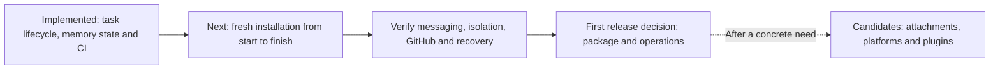

# Development roadmap

This roadmap records the priorities reviewed on October 30, 2026. The repository is the source of truth for current behavior. At that review, the goal was to verify installation, execution, recovery and delivery with the official Codex CLI before deciding on a first release or expanding the scope. Implementation, isolated testing, actual message receipt and deployment each require their own evidence.

## Status at review

| Area | Implementation | Verification and remaining work |
| --- | --- | --- |
| Durable tasks, waits, revisions, cancellation and recovery | Implemented | Selected live Feishu flows covered restart and reattachment, cancelling waits and cancelling running tasks. Fault injection covered unknown delivery and lost descendants. |
| Installation, upgrades and data protection | Implemented | Local rebuilds, updates and restarts preserved configuration and Codex login. Clean installation and backup restoration still needed acceptance testing. |
| Data storage | Refactored | Schema v16 removed named-resource fields and switched memories to directories. Schemas 13–15 can migrate with history. Older development databases require rebuilding. Historical archiving was pending. |
| Organization access, shared directories and MCP, group PR reviews | Implemented | Receipt was confirmed for a specific group and repository. Multi-member access, revocation and cross-tenant combinations still needed live testing. |
| Markdown, image inputs and file delivery | Limited scope implemented | Live Feishu execution, receipt, downloaded contents and matching SHA-256 were verified. One PNG was confirmed. Multiple images, JPEG, long text and multiple clients remained to test. |
| First card and public progress | Implemented | Regression tests covered the 200 ms coalescing window, real event summaries and tool records. First-card P95 and full client rendering remained to measure. Image previews and streaming updates were pending. |
| Assistant, profiles and automatic long-term memory | Implemented | Direct-chat extraction, recall in a new session and exclusion after deletion were verified. The workbench shows waiting, running, retry, failure and empty results. Multi-user privacy and extraction quality remained to test. |
| GitHub login, check waits and API | Implemented | A local `gh` login was verified for private PR checks and receipt after a wait. Simplified account permissions and API writes were covered mainly by isolated tests. |
| CLI and workbench | Implemented | The workbench had browser acceptance coverage. The terminal menu had local interactive and isolated tests, and Codex device login was verified. Real Docker and terminal MCP OAuth flows remained to test. Earlier checks apply to the versions tested. |
| Remote MCP | Implemented | Public HTTPS, OAuth, Bearer tokens and direct calls after authorization were supported. Live Linear reads were verified. External writes and preregistered OAuth clients still needed verification or implementation. |
| Scheduled reminders and tasks | Implemented | Users could create and manage schedules in direct chats and inspect them in the workbench. Automated tests covered fixed intervals, coalescing missed triggers and revocation. Live scenarios and recovery remained to test. |
| Continuous integration | Configured | Main pushes and PRs build, run tests and check package contents on Linux and macOS using isolated fixtures. Check GitHub Actions for run results. |
| Direct Git pushes | Limited safeguards implemented | A local bare repository and the UI flow were verified. Real HTTPS and SSH targets remained to test. |
| OpenClaw migration | Partially implemented | Source inspection and import were available. Takeover and rollback states existed in internal modules and tests. The complete management flow and live switch remained pending. |
| Other agents | Implementation withdrawn at this review | The SDK, probes, registration and switching had been removed. Internal interfaces and compatibility for existing Codex tasks remained. |

Live checks on October 27, 2026 covered Feishu execution, the memory lifecycle and file delivery. On October 28 they covered Linear OAuth reads and the per-call approvals used at the time. Build results, automated regressions, official protocol checks, actual receipt and local packaging were tracked separately. Check the workbench for the running version after subsequent source changes.

## Priorities at review

Complete P1 acceptance work first. Schedule P2 based on use and concrete requests.

| Order | Work | Completion criteria |
| --- | --- | --- |
| 1 · P1 | Fresh installation | Follow the docs from clean package install through init, isolated login, pairing or organization admission, first task, workbench save/apply and upgrade. Preserve data and login and run a single receiver. |
| 2 · P1 | Messaging experience | Cover materials, revisions, questions, stop and final replies across direct chats, group topics, desktop and mobile. Measure P95 until the platform accepts the first readable feedback, targeting ≤ 2 s. Record client display separately. |
| 3 · P1 | Permissions and long-term memory | Test two users, changing group membership and directories, revocation, correction and deletion across old and new sessions. Keep private facts restricted and exclude disabled memories from new runs. |
| 4 · P1 | Complete GitHub workflow | Exercise CI changes, changed HEAD, timeout, cancellation, revocation and restart. Verify dedicated tokens and account API writes against separately authorized targets. Reconcile unknown outcomes without retrying. |
| 5 · P1 | Backup recovery drill | Restore to an isolated directory. Verify tasks, memories, file records and login. Protect current data and avoid starting a second receiver. |
| 6 · P2 | Long-running operation and retention | Define policies for log rotation, history, artifacts, old snapshots and backups. Preserve unresolved tasks and receipts. Measure query and backup time as data grows and test low-disk behavior. |
| 7 · P2 | Live Git push | Name the HTTPS or SSH test repository, commit and branch. Verify direct execution, invalidation after changes and read-only reconciliation for unknown results. Document the limits of protection. |
| 8 · P2 | Complete OpenClaw migration | Expose takeover and rollback state in management, then verify conflicts, repeat imports, interrupted recovery, switching a single receiver and rollback with a live source. |

At this review, the first release still required a package name, license and publication approval, and the package was to retain `private: true` until then. Rollback across schemas is unsupported. Preserve messages received after an upgrade.

## Deferred work

- Revisit controlled image previews and CardKit streaming after verifying first-card and ordinary progress delivery.
- Add PDF, Office, audio and video parsing, richer attachments and offline catch-up as use cases justify them. Document which formats can be parsed and which can be delivered.
- Define the lifecycle and permissions for additional agent plugins, dynamic loading, multi-agent routing and proactive dispatch when there is a concrete need.
- Consider a second chat platform, Linux background services and a graphical installer after the existing installation and maintenance paths are stable.

See [Architecture](architecture.md) for technical design and the [documentation index](README.md) for the Git snapshot containing historical acceptance records.
